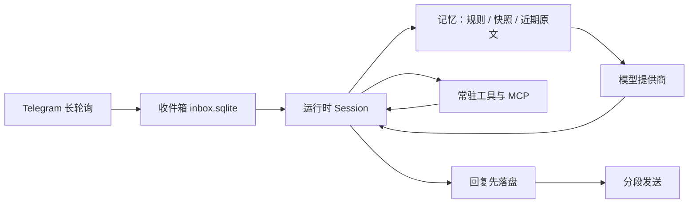

# Aster

[](https://www.typescriptlang.org/) [](https://nodejs.org/) [](https://grammy.dev/) [](https://nodejs.org/api/sqlite.html) [](https://docs.docker.com/) [](docs/mcp.md) [](https://www.npmjs.com/package/@earendil-works/pi-durable) [](LICENSE)

个人 AI agent，当前从单 owner 的 Telegram 私聊接收消息，在可恢复的 durable 执行环境里运行 agent 与工具，再把回复分段送回。它有长期记忆、能接入 MCP 工具，面向一台小规格云服务器长期运行。

功能开发按 `docs/spec-YYYYMMDD-<feature-name>.md` 临时规格推进，日期取本次开发开始当天。一个功能可有多个 spec，均引用同一份长期保留的功能 ADR；ADR 按时间记录各部分的取舍、缺陷与 spec 名称。功能开发完成后删除临时 spec，见 [按功能的临时规格](docs/README.md#按功能的临时规格)。下面描述当前可用能力。

基于 `@earendil-works/pi-durable`（1.3.0）构建。现已部署在腾讯云服务器上并持续运行：真实服务器上的 Telegram 往返、记忆落盘和容器重启恢复都在这次运行里。日期、镜像 digest 等脱敏细节还没写进仓库，可以补在 [部署指南](docs/deployment-test-guide.md#9-上线判定与验证边界)。

## 架构

一条消息的路径：Telegram 长轮询 → 渠道层收件箱落盘 → 运行时恢复或推进会话 → 记忆层组装上下文 → 模型层调用提供商 → 工具层执行 → 回复落盘后分段发送。



| 层 | 职责 | 主要文件 |
| --- | --- | --- |
| 入口与部署 | 组合接线、部署渲染、环境预检、发布清单 | `src/main.ts`、`src/deployment-*.ts`、`src/release-*.ts` |
| 渠道 | Telegram 长轮询与所有者过滤；持久化收件箱（offset 检查点、分段投递与对账） | `src/telegram.ts`、`src/inbox.ts` |
| 运行时 | 基于 pi-durable 的 Session：durable 执行、checkpoint、replay 恢复 | `src/agent.ts` |
| 记忆 | 归档、工作状态、压缩、上下文规划与快照、生命周期接入与记忆工具 | `src/memory/` |
| 工具 | 工具注册表（常驻 + deferred）、MCP 接入与 OAuth 凭据保管 | `src/tools.ts`、`src/mcp*.ts` |
| 模型 | 提供商注册表与模型解析、启动前目录校验 | `src/providers.ts` |
| 配置 | `.env` 解析与严格校验（缺项/错项启动前失败） | `src/config.ts` |
| 平台能力 | 能力清单、集成状态、能力解析、初始化状态机与宿主组合 | `src/platform-capabilities.ts`、`src/integrations.ts`、`src/capability-resolver.ts`、`src/bot-provisioner.ts`、`src/platform-runtime.ts` |
| 控制台 | HTTP + SSE、Web Token、零配置界面 | `src/console.ts`、`dashboard/web/index.html` |
| 存储 | 会话/checkpoint/记忆与投递状态，位于数据目录 | `agent.sqlite`、`inbox.sqlite` |

数据目录：

| 路径 | 内容 |
| --- | --- |
| `agent.sqlite`（及 WAL） | 底座会话与执行恢复状态；记忆系统的 working 状态、周期快照投影、归档进度与轮数计数 |
| `inbox.sqlite`（及 WAL） | 请求消费位置、身份绑定与投递状态 |
| `workspace/` | agent 的任务文件 |
| `memory/daily/YYYY-MM-DD.md` | 每日事件记忆：归档任务从已确认的会话范围增量提取 |
| `mcp.json`（可选） | MCP server 配置 |
| `mcp-oauth/<server>.json`（可选） | 远程 MCP server 的 OAuth token，仅属主可读 |

约束：同一数据目录只允许一个应用进程（镜像入口以 `flock` 互斥）。数据目录绑定 bot 与 owner，不能换身份续用。当前为单会话、串行请求、顺序工具执行，单个请求等待上限 5 分钟，超时向底座请求取消（外部副作用不保证可撤销）。接入每次最多取 10 条 update，处理完本地待办再轮询。

## 开箱即用：首次进入即可对话（默认）

默认部署不需要用户配置 Tool、MCP、API Key、Capability 或 Agent Runtime。服务启动时自动创建并
初始化第一个 Bot（`default`），分配持久化会话、工作区与运行时环境；控制台或 Telegram 首次
接入即可直接交代任务。创建新 Bot 只需一个名称（`POST /api/bots` 仅接受 `name`、可选
`systemPrompt` 与 `botId`）。能力由平台清单决定，用户不需要理解 Registry / Pin / Tier / Catalog。

- **诚实状态**：宿主按部署事实生成能力清单（core / memory / web / workspace / computer / task /
  integration），未部署的服务在控制台「平台状态」与 `GET /api/platform` 中标为 `unavailable`。
  可选能力缺失时 Bot 为 `degraded`（仍可对话），基础运行环境不可用或健康检查失败时为 `failed`
  （禁止对话），不会伪造 Ready。「你好，我已经准备好了。」是平台状态提示，不是模型生成的回复，
  也不写入会话。
- **幂等与恢复**：初始化状态持久化在 `inbox.sqlite` 的 `bot_provisioning` 表，claim/finish 走
  `BEGIN IMMEDIATE`；并发请求共享一次尝试，崩溃后的 `provisioning` 按未知结果重新认领，重启会
  对同一工作区与会话重新体检并重建内存中的会话目录。失败可经 `POST /api/bots/:id/retry`
  重试，重试不分配第二个工作区或会话。
- **能力来源**：`PLATFORM_WEB_SEARCH_API_KEY` 是宿主自有凭据（与 `CCR_PROFILE` 互斥），不进模型
  上下文、工具声明、Bot 行或日志；`PLATFORM_SANDBOX_VERIFIED=1` 要求已配置并验收的远程执行面，
  否则 Computer 能力（`bash` / `codemode`）默认关闭，宿主 bash 不作为安全默认值。
- **外部集成**：本阶段只实现 `disconnected | authorization_pending | connected` 状态抽象与授权
  请求接口（`integration_status` / `integration_request`、`POST /api/integrations/:service/
  authorization-requests`）。授权请求只登记 pending，返回 `connected: false`，不会伪造连接；
  完整 OAuth 接入留到下一阶段。模型不能自行注册工具、授予权限或读取凭据。
- **旧能力面**：`ALLOW_LEGACY_CATALOG=1` 才开放显式 `profile` / `toolScope` 与 `PATCH`，仅供
  `dashboard/acceptance/run.sh` 的旧版验收使用；正常部署默认为 0。

设计取舍与已知边界见 [ADR-0023](docs/adr/zero-setup-bot-runtime/0023-zero-setup-bot-runtime.md)。
零配置流程由 `test/zero-setup.test.ts` 与 `test/zero-setup-wiring.test.ts` 覆盖；真实模型供应商、
远程 sandbox 与控制台的部署验收仍需运维在目标机器上执行，仓库不把未执行的部署验证记为通过。

## 已验证与尚未验证

生产状态以所有者确认为准。下面的测试和 CI 数字以仓库里的记录为准。

**已有记录**

- 类型检查、离线测试和构建。2026-10-29 的 main 运行 [40826470475](https://github.com/NaoYUN77/Aster/actions/runs/40826470475)（提交 `07876f8`）中，Node job 为 235 项、227 过、0 失败、8 跳过。这 8 项是卷预检里需要 root 或单独 Docker 开关的用例；同一运行的镜像 job 另跑了对应检查（8 过 1 跳过，以及只读 WAL 1/1）。
- 最终镜像与单服务拓扑 6 项：Compose 边界、缺 provider key 时不回显凭据、同卷 `flock`、离线卷预检与整卷备份还原、容器日志不含合成凭据。脚本写明不覆盖真实 Telegram／模型链路，见 [CI 运行入口](docs/ci-entrypoint.md)。
- 记忆机制的离线验收，以及一次 DeepSeek 真实模型补测（28 次调用里 27 次前缀缓存命中，约 87%）。腾讯云 4 核、7680 MB 的机器在同一份记录里跑过验收测试和资源测量（峰值 RSS 约 136 MiB）。那是测试补测，不是部署验收。见 [记忆系统验收](docs/memory-verification.md)。
- 启动配置在联网前拒绝未知提供商和未知模型 id；进程日志只打印本应用的配置／状态错误或错误码（`src/config.ts`、`src/main.ts`）。这是代码和测试里的行为，不是一份生产日志审计。
- 生产环境已部署在腾讯云服务器上并持续运行，包括真实服务器上的 Telegram 往返、记忆落盘和容器重启恢复。仓库里还没有日期或镜像 digest，见部署指南第 9 节的可选记录。

**仓库记录尚未覆盖**

- CI 里的 Telegram → 模型 → 投递业务链。当前拓扑日志写的是 NOT COVERED。
- 镜像发布、签名和手动生产更新。没有 `release.yml` / `deploy.yml`；离线发布预检成功时仍标注 `productionAdmission: "not-evaluated"`。
- DeepSeek 以外的提供商的真实摘要与归档质量。

**已知限制**

- 回复已持久化但请求收尾未执行时进程被杀，该轮的轮数计数会永久滞后一轮（回复与状态一致，压缩评估点后移）。见 issue #26。
- 单会话串行。长期繁忙时消息留在 Telegram 侧。
- `bash` 等工具不是沙箱。零配置模式下未验收 OS 隔离时 Computer 能力默认关闭；QuickJS 只约束脚本，其嵌套 `bash` 调用仍具有执行面权限。
- 本阶段没有真实 OAuth 集成连接、供应商实时连通性探测、已验收的 OS 级沙箱，也没有进程内多用户账号体系（跨用户隔离仍按独立 `DATA_DIR` 部署）。Memory 仍是全局而非每 Bot 独立；容器 dashboard overlay 的原始 bash 仍可列出兄弟工作区目录。见 [ADR-0023](docs/adr/zero-setup-bot-runtime/0023-zero-setup-bot-runtime.md)。

## 对话示例

> **TODO（维护者填写）**
>
> 放一段脱敏后的真实 Telegram 往返。不要编造对话。建议包含一条普通请求、一次工具调用、一次「记住这件事」，以及进程重启后的追问。删掉 token、用户 ID、文件路径和任何密钥。
>
> 在补上之前，本节不是能力证据。

## 快速开始

需要 Node.js 24.19.0+，以及可访问 Telegram 与所选模型服务的网络。

```sh
npm ci
cp .env.example .env
# 填写 .env（见下）
npm run check
npm test
npm run build
npm start
```

开发运行用 `npm run dev`。测试全部离线（faux 模型 + 本地 SQLite），不调用收费模型或 Telegram。

`.env` 必填项：

- `TELEGRAM_BOT_TOKEN`：BotFather 创建的 bot token。
- `TELEGRAM_OWNER_ID`：允许使用 bot 的个人 Telegram 数字用户 ID。
- `MODEL_PROVIDER` / `MODEL_ID`：注册表内的提供商 id 与该提供商在 pi-ai 1.3.0 模型目录中的 id。写错时启动前报错并列出示例，不自动替换。
- 所选提供商对应的 API key（见下表；只要求当前所选的那个，其余留空不算缺项）。

| `MODEL_PROVIDER` | API key 变量 |
| --- | --- |
| `anthropic` | `ANTHROPIC_API_KEY` |
| `openai` | `OPENAI_API_KEY` |
| `deepseek` | `DEEPSEEK_API_KEY` |
| `google` | `GEMINI_API_KEY` |
| `xai` | `XAI_API_KEY` |
| `mistral` | `MISTRAL_API_KEY` |
| `groq` | `GROQ_API_KEY` |
| `moonshotai`、`moonshotai-cn` | `MOONSHOT_API_KEY` |
| `minimax` | `MINIMAX_API_KEY` |
| `zai` | `ZAI_API_KEY` |
| `openrouter` | `OPENROUTER_API_KEY` |

注册表定义在 `src/providers.ts`，是支持范围的唯一来源。本应用只支持显式 API key 的提供商：不含 OAuth／订阅登录、云厂商环境凭据（Bedrock、Vertex），暂不支持自定义 base URL 的 OpenAI 兼容端点。

常用可选项（均有默认值，注释里的数字与 `src/memory/contracts.ts`、`src/config.ts` 一致，完整清单见 `.env.example`）：

- `DATA_DIR`：持久化数据目录，默认 `./data`（Docker 部署固定为 `/data`）。
- `TELEGRAM_API_ROOT`：Telegram Bot API 的根地址覆盖。服务器无法直连 `api.telegram.org` 时，可指向自建 https 反向代理。仓库没有记录这项是否在某台机器上使用。
- `MEMORY_ENABLED`：记忆系统总开关，默认开；设 `0` 整体关闭。其余 `MEMORY_*` 为预算、时区与归档超时。
- `CODEMODE_ENABLED`：PTC／code mode 总开关，默认关；设 `1` 启用 `codemode` 工具。`CODEMODE_TIMEOUT_MS` 与 `CODEMODE_MEMORY_LIMIT_BYTES` 约束脚本期限和 QuickJS 内存。
- `MCP_CONFIG`：MCP 配置文件路径，默认 `DATA_DIR/mcp.json`。
- `PLATFORM_WEB_SEARCH_API_KEY`：宿主自有 Web 凭据，零配置模式下自动为所有 Bot 提供 `web_search` / `web_fetch`；与 `CCR_PROFILE` 互斥，不进模型上下文、Bot 配置或日志。未设置时 Web 能力明确标为 `unavailable`。
- `PLATFORM_SANDBOX_VERIFIED` / `ALLOW_LEGACY_CATALOG`：见「开箱即用」一节；前者默认 0（Computer 关闭），后者默认 0（零配置）。
- `CCR_PROFILE`：**旧版兼容路径**，仅在 `ALLOW_LEGACY_CATALOG=1` 且 `profile.web=true` 且 `toolScope` 允许时提供 CCR 的 WebSearch 与 WebFetch。`CCR_COMMAND` 可覆盖可执行文件名，默认 `ccr`。CCR 与 Claude Code CLI 必须在应用运行环境内可用。
- `LANGFUSE_PUBLIC_KEY` / `LANGFUSE_SECRET_KEY`：可选；两个都设置时启用 Langfuse Cloud Trace，可用 `LANGFUSE_TRACING_ENABLED=0` 临时关闭。默认只上报 id、长度、计数、工具名和错误码，不上传消息、脚本、参数或文件内容。MITM 模式下 secret key 使用 `__vault_LANGFUSE_SECRET_KEY__`。配置、隐私边界与验收步骤见 [Langfuse Tracing](docs/langfuse-tracing.md)。

私聊 bot 后直接发送文字即可。bot 若已配置 webhook，应用会拒绝启动，需先在原部署中停用 webhook。

## 记忆系统

每次请求的上下文分三区：A 区为稳定规则（系统提示与工具声明，保持不变以利用提供商前缀缓存）；B 区为周期快照（连续性摘要与 working 基线，只在压缩或重置正式生效时切换）；C 区为实时尾巴（近期原文、工具结果与本轮检索结果）。

| 工具 | 用途 |
| --- | --- |
| `working_read` / `working_update` | 读取 / 按预期版本更新当前任务状态 |
| `memory_search` | 按关键词与日期范围检索每日事件记忆 |
| `memory_read` | 按日期 + 段落 id 精确读取一条每日事件 |

已确认的会话范围由后台归档任务增量提取为 `memory/daily/*.md`。归档失败只记录状态，不影响聊天。检索超限返回明确错误，不静默截断。早期的 `workspace/MEMORY.md` 已退役，见 [ADR-0004](docs/adr/0004-retire-workspace-memory-md.md)。

设计见 [Memory 与 Context 实施方案](docs/memory-and-context-design.md)，验收记录见 [记忆系统验收](docs/memory-verification.md)。

## 工具

> 默认零配置部署由平台能力清单自动解析目录与权限，用户不提交 `profile`（见「开箱即用」）。
> 下面描述的显式八开关仅在宿主级兼容开关 `ALLOW_LEGACY_CATALOG=1` 开启时有效；无论哪种模式，
> 实际执行仍经 Registry 的声明过滤与 `review()` 复核，全局注册不等于有权执行。

工具按完整 `profile` 中的八个布尔开关 `core`、`shell`、`files`、`web`、`ptc`、`memory`、`reminders`、`mcp` 授权，`toolScope` 可进一步按工具名收窄。`DEFAULT_CATALOG_PROFILE` 为 `core/shell/files/memory/reminders/mcp=true`、`web/ptc=false`，用于 bootstrap 与控制台创建表单初值；正常 API 创建仍必须显式提交全部八个字段，可附带 `toolScope`，不接受或返回 bot role。宿主 `configureBot` 同样必须传完整 `catalogProfile`，没有 tools-only 回退。`tools` 仅是受部署可用性限制的兼容输出投影，不参与授权。

`shell` 选择 `bash`，`files` 选择 `read`／`write`／`edit`，`core` 选择 `current_time`／`tool_search`；记忆、提醒、Web、PTC 与 MCP 分别由对应开关选择，并要求部署提供相应服务。工具目录、模型声明、MCP 延迟发现、直接执行与 PTC 嵌套调用使用一致的 profile／toolScope 鉴权。完整分组、接口与历史数据库升级见 [工具目录](docs/tool-catalog.md)。MCP 的配置字段、pin、授权、OAuth 和检查命令见 [工具与 MCP](docs/mcp.md)，通用工具契约见 [契约与生命周期](docs/contracts-and-lifecycle.md)。

### 代码调用工具（PTC，可选）

设置 `CODEMODE_ENABLED=1` 并重启后，`profile.ptc=true` 且 `toolScope` 允许的 bot 获得 `codemode` 工具：它写一段 JavaScript，在 QuickJS WASM sandbox 中调用白名单工具，只有脚本结果回到对话。本地脚本可调用 `read`／`write`／`edit`／`bash`；远程执行模式只开放 `bash`。每个嵌套目标仍须通过所属能力组与 `toolScope` 授权，并在宿主侧串行执行；开启 `ptc` 不会开启其他能力组，PTC 也没有额外的角色硬拒绝。模型可见结果上限 32 KiB／1000 行。QuickJS 只限制脚本运行时能力，不是 OS 沙箱，`bash` 仍具有宿主权限。配置、失败语义、恢复边界和远程大输出处理见 [代码调用工具](docs/codemode.md)，取舍见 [ADR-0019](docs/adr/codemode-ptc/0019-codemode-ptc.md)。

## 部署与运维

生产形态是单个 Docker 服务。镜像构建、Compose、卷备份和上线清单见 [部署指南](docs/deployment-test-guide.md)。同机 test／production 的环境描述见 [部署环境](docs/deployment-environments.md)。结果未知的 Telegram 发送如何核查和补发见 [投递核查与补发](docs/deliveries.md)。

凭据只经部署环境提供。应用只做存在性与形状校验，不把秘密写入工具参数或 durable 状态。

可选的 MITM 占位符模式（密钥留在 OpenBao，应用只见 `__vault_<NAME>__`）见 [OpenBao + MITM 部署](deploy/openbao-mitm/README.md)，应用侧 overlay 为 `docker-compose.mitm.yml`。代理只在客户端显式发送占位符、且目标 Host 精确命中 [`allowlist.json`](deploy/openbao-mitm/addon/allowlist.json) 时才填充；不按目标自动补 `Authorization`，不替换请求体，无映射返回 `403`。

### 远程工具执行（阶段 1，可选）

可选的 `docker-compose.execution.yml` overlay 把命令工具（`bash`）放到第二台 VPS 执行：应用容器经宿主共享 Unix socket 调用宿主网络里的 `execution-broker`，由 broker 从 Aster 主机 SSH 到执行 VPS。控制面仍保留会话、记忆与投递状态；应用容器不新增网络、不发布端口，MITM／OpenBao／allowlist 的隔离语义不变。

阶段 1 只支持 shell；`read`／`write`／`edit` 等文件工具在远程模式下返回 `not_supported`，文件工作请用 `bash`。broker 不可达时应用启动失败，不回退本地执行。socket 目录权限、SSH 密钥与 known-hosts 路径（示例均为占位）、检查命令与失败语义见 [远程工具执行](docs/execution-remote.md)，设计取舍见 [ADR-0021](docs/adr/0021-control-execution-split.md)。

### Web 工具

零配置模式下设置 `PLATFORM_WEB_SEARCH_API_KEY` 即可让所有 Bot 获得 `web_search` 与 `web_fetch`；凭据只存在于宿主配置中。下面是 `ALLOW_LEGACY_CATALOG=1` 时的 CCR 兼容路径。

设置 `CCR_PROFILE` 为 CCR Agent Profiles 中已启用的 Claude Code profile 后，`profile.web=true` 且 `toolScope` 允许的 bot 获得 `web_search` 与 `web_fetch`。每次调用都会通过 `ccr <profile> cli -- <Claude Code args>` 启动非交互 Claude Code CLI；Search 和 Fetch 分别只允许对应的原生 `WebSearch` 或 `WebFetch` 工具，并禁用额外 MCP 配置。未配置 `CCR_PROFILE` 时部署不提供 Web 工具，已保存的 `profile.web` 开关不会因此改写。兼容 `tools` 字符串在 bot 激活时按已保存的开关与部署可用性刷新。

CCR、Claude Code CLI 与 profile 必须在应用运行环境内已配置。子进程等待上限 60 秒，stdout/stderr 有大小限制；超时、启动失败和非零退出都会作为工具错误返回。Web Fetch 只接受无凭据的公网 HTTP(S) URL，并拒绝本地地址。Web 工具是只读授权，但因外部调用结果可能变化，工具不可自动重放。

## 开发

```sh
npm run check   # 类型检查
npm run build   # 构建
npm test        # 全量离线测试
```

## 文档索引

- [文档分类索引与临时 spec 约定](docs/README.md)：按功能推进开发，区分当前契约、运行手册、任务记录和历史材料
- [部署指南](docs/deployment-test-guide.md)：镜像交付、备份恢复、维护命令、上线清单
- [投递核查与补发](docs/deliveries.md)
- [Langfuse Tracing](docs/langfuse-tracing.md)：可选 Trace 的配置、隐私边界、部署与首条验收
- [工具与 MCP](docs/mcp.md)
- [部署环境描述](docs/deployment-environments.md)
- [远程工具执行](docs/execution-remote.md)：阶段 1 的宿主 broker、SSH 基线、配置与失败语义
- [契约与生命周期](docs/contracts-and-lifecycle.md)
- [ADR](docs/adr/)：决策记录
- [Memory 与 Context 实施方案](docs/memory-and-context-design.md) / [记忆系统验收](docs/memory-verification.md)
- [CI 运行入口](docs/ci-entrypoint.md) / [主机备份与演练](docs/host-backup.md)
- [CI/CD 实施计划](docs/ci-cd-implementation-plan.md)
- [历史 Docker 验证记录](docs/docker-verification.md)：对应当日拓扑，不代表当前部署状态
- 仓库级约束见 [CLAUDE.md](CLAUDE.md)
